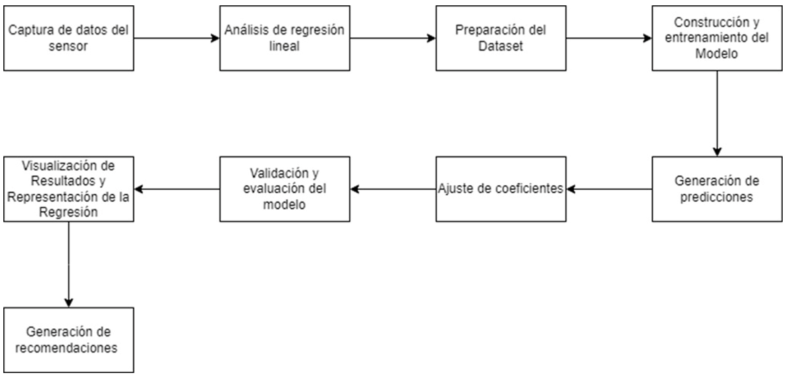

# 🌱 Sistema Experto de Recomendación para Cultivo de Papa

Este proyecto implementa un sistema experto que recomienda prácticas de fertilización para el cultivo de papa. Basado en parámetros como pH, humedad del suelo y niveles de nitrógeno (N), fósforo (P) y potasio (K), el sistema sugiere la mejor forma y momento para aplicar fertilizantes.

La versión de este repositorio, no es la final o la utilizada en proyecto real, es un borrador para el proyecto real

## 🧠 Objetivo

Brindar recomendaciones precisas para mejorar la eficiencia en la aplicación de fertilizantes, evitar lixiviación y maximizar la calidad y el rendimiento del cultivo de papa.

## 📁 Estructura del Proyecto

```
SE/
├── SE.py                # Script principal: lógica del sistema experto
├── regresionLineal.py   # Módulo de regresión lineal para predicción de absorción
├── Diagrama.png         # Diagrama funcional del sistema
├── README.md            # Documentación
└── requirements.txt     # Dependencias necesarias
```

## ⚙️ Instalación

1. Clona el repositorio:
```bash
git clone https://github.com/criseen7/SE.git
cd SE
```

2. Crea un entorno virtual (opcional):
```bash
python -m venv env
source env/bin/activate  # En Windows: env\Scripts\activate
```

3. Instala las dependencias:
```bash
pip install -r requirements.txt
```

## 🚀 Uso

Ejecuta el script principal con:
```bash
python SE.py
```

## 📊 Resultados esperados

Ejemplo de salida:

```
Método recomendado: Fertilización en bandas durante la siembra
Advertencia: Niveles de fósforo bajos, se recomienda aplicación localizada
Evite fertilización tardía: puede afectar calidad de almacenamiento
```

## 📌 Tecnologías utilizadas

- Python 3
- Lógica condicional tipo sistema experto
- Regresión lineal
- Visualización simple (matplotlib opcional)

## 🧪 Ejemplo de recomendación



> Si el pH está entre 5.5 y 6.5 y la humedad es > 60%, se recomienda fertilización foliar con control de lixiviación.

## ✍️ Autor

**Cristofer Raziel HB**  
GitHub: [@criseen7](https://github.com/criseen7)
